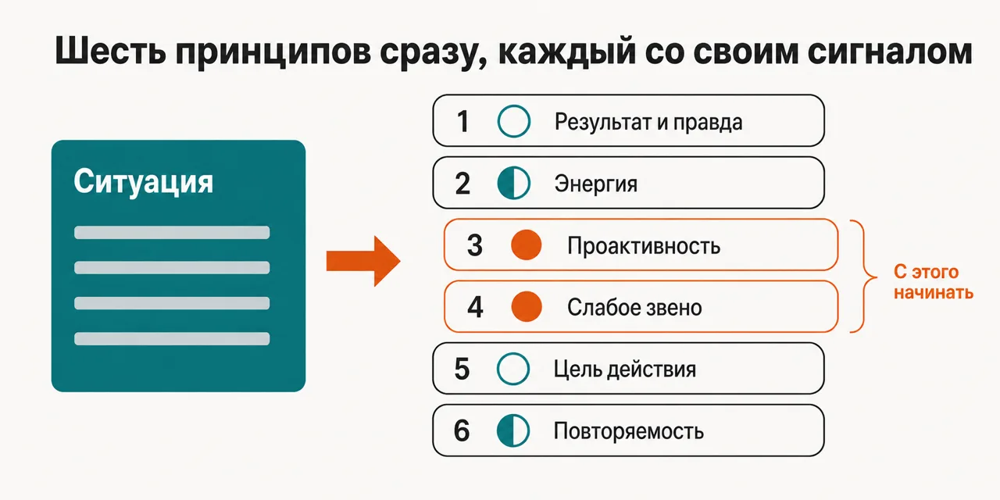
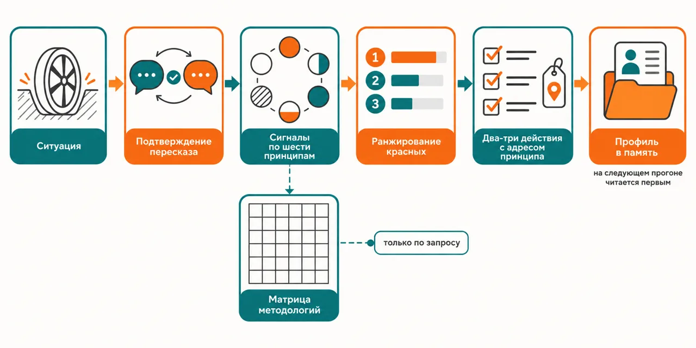

English · [Русский](README.md)

# The project is stalling — and the argument is about which framework to adopt instead of the current one

Six principles that sit underneath PRINCE2, PMBOK, P3.express, DSDM, Scrum and XP are checked all at
once, each one gets a green, yellow or red signal, and the check covers the methodology you are
running on right now.

Since 1.1.0 the same six principles also work for an AI agent. `/nupp:guide` loads them as standing
rules of the session. `/nupp:check` checks a plan, a brief, a report or a decision against them and
returns only the violations.

```
claude plugin marketplace add https://github.com/beCyborg/jadlis-start.git
claude plugin install nupp@jadlis
```

No keys are needed at all and the plugin never goes online: the install asks for one thing only —
a folder on your disk for advisor memory — and if you leave it unset the advisor still works, it
just says so in its first line and remembers nothing.



In words: on the left, the project situation in your own words; on the right, six principles each
with its own signal, and the red ones pulled to the front as the place to start.

This is my workbench published as it is, not a product: whatever I stopped using, I removed.

## Before → after

| By hand | With an AI chat | With this plugin |
|---|---|---|
| **What the stalling gets blamed on.** The explanation grows out of whichever methodology the team knows best, and other causes never come up. | It answers inside the frame named in the question: ask about Scrum, get an answer about Scrum. | All six principles are applied simultaneously rather than in turn: each gets green, yellow or red, and the table shows which link is the weak one. |
| **What to do with the list of findings.** A dozen places turn up where things are not by the book, and there is nothing to rank them by. | It returns a list of recommendations as long as a handbook — and none of it gets done. | Reds are ranked by impact on the outcome and no more than two or three items come back: the same 80/20 rule the advisor checks in your project is applied to its own output. |
| **How closely the advice fits this project.** Advice from a book is written for projects in general; fitting it to your case is on you. | "Be more proactive" sounds like an answer and slips through unnoticed. | Every recommendation has to name the alternatives, the principle with its file address, and the binding to your project type, methodology, role and stage — otherwise it is a truism, and the verdict makes that visible. |
| **How a methodology gets picked.** The Agile-versus-Waterfall argument is about camps and certificates, not about the project's outcome. | It names whatever appeared most often in the texts, with no tie to your context. | A coverage matrix is built: six principles by six methodologies, every cell Strong, Moderate or Weak for your project, plus a tailoring plan for what the methodology does not cover. |
| **What is left after the discussion.** A quarter later nobody remembers which link was weak or what was done about it. | The chat history does not carry into the next conversation. | A project profile with the signals across all six principles goes into the memory folder, and the next run reads it first — then asks which parts of it still hold. |

## How it works



Going in — project type, methodology, your role, the stage, and what exactly went wrong.
Inside — the situation is read back to you for confirmation, then six principles work as six
diagnostic lenses at once and each gets its colour.
Coming out — the reds in order of impact, two or three concrete actions, and a project profile in
the memory folder.

In words: situation → confirmation of the read-back → signals across six principles → reds ranked →
two or three actions each with a principle's address → profile into memory.

Six things get checked, and they are named: allegiance to a camp versus results and truth; energy
and resources; proactivity; the weakest link; the purpose of every activity; repeatable elements.
Each one has its own file behind it with the original text of the NUPP manual: the statement of the
principle and its worked examples. It is read when that signal lights up rather than all six up front.

The reasoning protocol demands four things of every recommendation: the alternatives considered and
why this one fits better, a reference to the principle with its file address, a binding to your
project instead of an abstraction, and the anti-pattern named outright when the situation matches
one. The anti-patterns are named in advance in the skill itself: method tribalism, cherry
picking practices from several methodologies instead of tailoring one, the anti-process fallacy,
purposeless activities, fire-fighting management, reinventing everything each time.

A questionable activity is tested by parallel worlds rather than by opinion: two worlds identical in
everything except this meeting, this report, this process — how different are they? If the
difference can be stated, that is the purpose, and it tells you what shape the activity should take.
If it cannot, the activity is redesigned or dropped.

The methodology matrix is not always built — only when the question is about choosing or evaluating
a methodology. There is no best one in general: coverage is computed for your specific project, and
the recommendation comes with a tailoring plan for the gaps. The advisor does not demand that you
change methodology — these principles sit underneath it, not instead of it, and advice is framed in
the terms of what you already use; when it contradicts that, the trade-off is said out loud.

**For an AI agent.** `/nupp:guide` puts a short text into the session context: the six principles
read for agent work, three checkpoints and the manager rules. The agent checks itself against the
principles when it takes a task, before an expensive or irreversible step, and before it says
"done". A small question gets a direct answer with no ceremony. While the principles hold, the agent
stays silent about them; a violation gets one line with the code of the principle. A manager session
gets two rules: what a brief for a worker must carry and how to accept a report.

`/nupp:check` takes one artifact — a plan, a brief, a report, a decision or a process rule — and asks
it the questions of all six principles. Only real violations come back, five at most: where it is
in the text, what it costs and how to fix it. A clean artifact gets a one-line "clean" verdict.

## Installing and the first run

**a) Text to paste to an agent.** Copy the whole thing into a Claude Code chat:

```
You are the installer. Install the plugin nupp from the jadlis marketplace on this Mac.
Run exactly these commands, verbatim, shortening nothing:
1. claude plugin marketplace add https://github.com/beCyborg/jadlis-start.git
2. claude plugin install nupp@jadlis
3. claude plugin list — show me the line about nupp and its version.
This plugin needs no keys at all, and it does not need the internet either. It asks for one
thing — the memory folder where the project profile is written: I name the path, not you.
Before each command show it to me in full and wait for "yes". If I say "no", do not run it,
tell me what you skipped, and move on.
If a command returns an error, stop, show me the output, and do not move to the next one.
```

**b) Commands by hand.**

```
claude plugin marketplace add https://github.com/beCyborg/jadlis-start.git
claude plugin install nupp@jadlis
claude plugin list
```

The first command installs nothing — it adds the marketplace. Only the second one installs, and one
line removes it: `claude plugin uninstall nupp@jadlis --keep-data`.

You can set the memory folder straight in the install — `claude plugin install nupp@jadlis --config
MEMORY_DIR=~/advisors-memory`. The setting is called `MEMORY_DIR`, it is optional, its default is
`~/advisors-memory`, and all Jadlis advisors can share one folder: this advisor's profile lives in
it at `Профили/adv-nupp.md`. The plugin unpacks the folder itself on the first run and never touches
existing files. Changing it later means reinstalling with `--config`: on an already installed plugin
that flag silently changes nothing (checked 2026-09-07). If the setting stays empty, the advisor
says so and carries on without memory.

**c) The short command.** Open Claude Code in the folder you work in and type:

```
/nupp <what is going on with the project>
```

If it is not found, check the name with `claude plugin list`. It will first ask for the project type
and size, the methodology, your role, the stage and what prompted the conversation — and if your
description already carries all that, it asks only for what is missing. Then it reads the situation
back in its own words and does not go further until you confirm it got it right.

The agent commands are:

```
/nupp:guide
/nupp:check <path to a plan, report or decision>
```

There are three ways to load `/nupp:guide`: type the command in any session; put it in the first line
of the brief a manager or worker session starts with; preload it into a subagent with
`skills: [nupp:guide]` in the agent file. The text stays in context until the session ends and
survives context compaction. It cannot be unloaded from a running session: say "NUPP off" and the
agent stops applying it.

## Limits, cost, updating

**What it does not do.** It does not run the project and does not replace the methodology: these
principles sit underneath it, so the advisor never proposes moving to a new framework. It does not
gather project data on its own — it works with exactly what you told it, and a partial account gives
a partial diagnosis. It does not go online and does not look at fresh data. It does not cross-verify
its own conclusions and keeps no claim ledger: there are no lenses answering separately and no
skeptics here — this is one analysis by one skill. It does not write a verdict as a separate file:
what goes into memory is only the project profile with its signals and session notes. It does not
hand back six findings at once — it names the one or two principles that are actually in the way.
And it does not replace a lawyer, an accountant, a financial adviser or a doctor: the boundaries are
in `NOTICE.md`.

**What you need.** No keys at all, no external MCP servers and no third-party CLIs either. You need
a folder on disk for advisor memory if you want the analysis kept, and a Claude Code with access to
Opus: the `/nupp` diagnosis is pinned to that model, while `/nupp:guide` and `/nupp:check` run on the
session's model. The principle files inside the plugin are written in
English — the conversation runs in your language, but quoted names of principles and anti-patterns
arrive in their English wording.

[уточнить] — the repository pins no minimum Claude Code version.

**Source.** The principles come from the NUPP manual by OMIMO (https://omimo.org/en/modules/nupp/).
Its original text sits in `skills/nupp/references/` under the Creative Commons Attribution 4.0
license. OMIMO took no part in this plugin and does not endorse it.

**How tokens get spent.** A run is light: one skill inside your session, no workflow and no subagent
fan-out — the heavy runs live in the advisor councils where lenses answer in parallel. Reading the
principle files costs more than the rest, which is why only the file behind a signal that lit up is
opened, not all six. `/nupp:guide` adds about 3.8 thousand tokens to the context (measured
2026-11-12 on Opus 5.5) and keeps them until the session ends. The conversation itself is long: the interview, the read-back confirmation and
the methodology matrix are added as needed, and you can stop after the signals without reaching the
matrix.

**Verified where I work:** my Mac, my subscription. Where else this works — [уточнить].

**Terms of use.** The NUPP manual text in `skills/nupp/references/` is Creative Commons Attribution
4.0, rights with OMIMO. The rest of the plugin has no open license: all rights reserved by the
author. Details are in `NOTICE.md`. You may read it and use it
personally. Commercial use, republishing and bundling it into your own products — by arrangement
with me.

**Updating.** With a third-party marketplace, auto-update is off on your side: until you run the
first command you keep the version you installed. The repository itself is assembled by a generator
from a private source, so a fix arrives here with the next release rather than as a commit to this
repository.

```
claude plugin marketplace update jadlis
claude plugin update nupp@jadlis
claude plugin list
```

Reinstall, if something ended up crooked:

```
claude plugin uninstall nupp@jadlis --keep-data && claude plugin install nupp@jadlis
```
